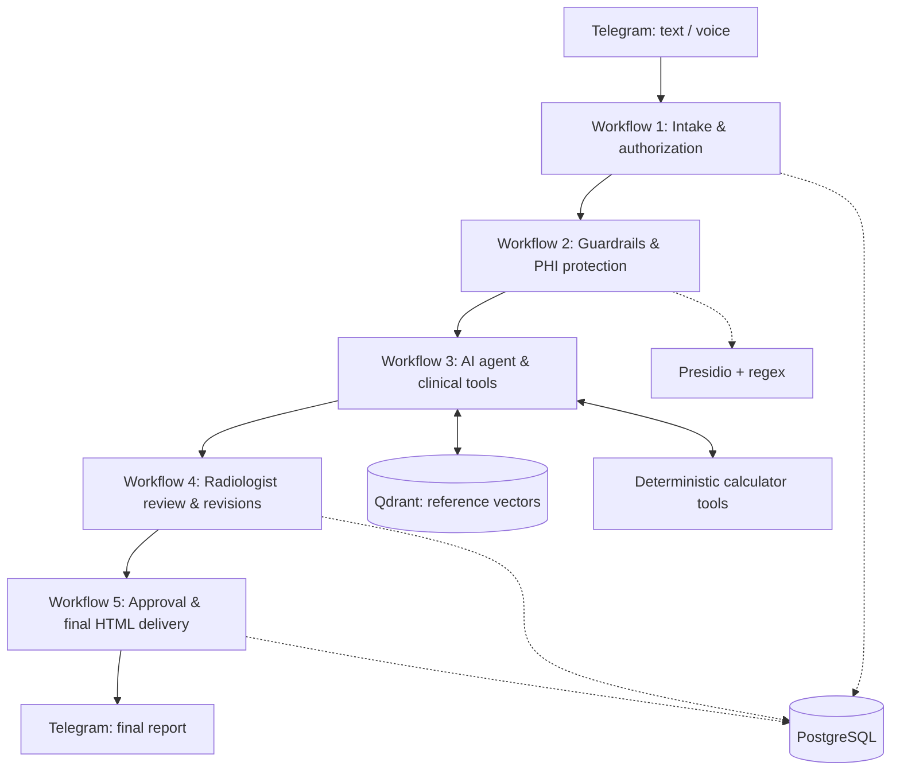

# RADRAFT — AI Radiology Reporting Assistant

**DEPI Graduation Project · Digital Egypt Pioneers Initiative · AI in Healthcare Track**

> **From imaging findings to structured radiology reports—with deterministic scoring, reference retrieval, privacy checks, and radiologist approval.**

RADRAFT is a Telegram-based radiology reporting assistant built with **n8n**. It helps radiologists turn text or voice descriptions of imaging findings into structured report drafts, use purpose-built calculator tools where applicable, retrieve supporting material from a medical knowledge base, review and request revisions, and receive a finalized HTML report.

**Clinical scope:** Decision support and report drafting for qualified clinicians. RADRAFT is **not** a substitute for radiologist interpretation or approval, and is not presented as a clinically validated autonomous diagnostic system.

## 1. Problem and proposed solution

Radiologists repeatedly convert unstructured findings into reports and may need to consult scoring systems and references during reporting. RADRAFT combines these tasks into a guided workflow while keeping a human review step before finalization.

**Users:** Radiologists and other authorized medical professionals involved in radiology reporting.

**Core journey:** Send findings via Telegram → validate access and protect identifiers → generate a draft using calculators and reference retrieval → approve or request targeted changes → receive a formatted report.

## 2. Features demonstrated in the project

| Capability | Implementation |
| --- | --- |
| Text and voice input | Telegram bot; voice transcription path |
| Doctor access control | PostgreSQL-backed authorization checks |
| Clinical guardrails | Topic, harmful-content, and prompt-injection checks in the workflow |
| PHI screening | Regex and Microsoft Presidio analyzer before external AI processing |
| De-identification | Placeholder replacement and trusted mapping retained for authorized restoration |
| AI report drafting | n8n AI Agent with a connected chat model |
| Deterministic calculations | Connected calculator tools for applicable radiology scoring workflows; results should be verified in execution logs |
| Medical RAG | Qdrant vector database, OpenAI embeddings, and Cohere reranking |
| Doctor-in-the-loop review | Telegram approval/adjustment and repeated targeted editing |
| Structured HTML output | Printable report with available patient/header details and doctor signature |
| Delivery | Final `.html` document sent to the doctor via Telegram |
| Usage quotas | PostgreSQL-backed session allowance and subscription-account logic |

> **Implementation note:** A configured tool is not evidence it ran on every request. Calculator invocations, retrieved sources, PHI detection, and final report quality should be checked in the n8n execution trace for each test case.

## 3. High-level architecture



### Workflow responsibilities

1. **Intake and authorization:** Accept Telegram messages, handle voice transcription if used, verify the doctor, and assemble a common payload (for example `chat_id`, `user_message`, and doctor/session details).
2. **Privacy and screening:** Apply guardrails, identify PHI with regex and Presidio, and produce a sanitized clinical input for external-model processing. Preserve sensitive mappings only inside trusted processing.
3. **Clinical assistance:** Draft the report, call an appropriate deterministic calculator when needed and its inputs are complete, and search Qdrant for relevant reference passages. Do not invent unavailable calculations or citations.
4. **Radiologist review:** Send the draft for approval or adjustment; edit the latest version based on specific feedback and allow further review. Re-run PHI protection before external editing calls.
5. **Finalization:** Take the approved report, build clean standalone HTML, fill verified metadata where available, send the document through Telegram, and apply eligible usage-account updates.

The n8n workflows communicate using **Execute Sub-workflow** and **Execute Sub-workflow Trigger** nodes. The payload is explicitly passed between workflows; nodes in one workflow cannot directly reference nodes inside another workflow.

**Telegram design:** A single primary Telegram trigger is used for the bot's inbound updates; subsequent workflow stages are called as sub-workflows. Telegram send-and-wait interactions support human review.

## 4. Technology stack

| Layer | Technology |
| --- | --- |
| Orchestration | n8n (Docker) |
| User interface | Telegram Bot API |
| AI models | OpenRouter-connected chat model; OpenAI embeddings for retrieval |
| Privacy processing | Microsoft Presidio Analyzer; custom JavaScript regex/placeholder logic |
| Relational data | PostgreSQL for doctor authorization, report/session and quota data |
| Vector search | Qdrant (`radraft_medical_guidelines` collection) |
| Relevance enhancement | Cohere reranker |
| File and source ingestion | Google Drive document retrieval, PDF text extraction, text splitting |
| Deployment during development | Docker Desktop and ngrok for public Telegram webhook access |
| Output | Standalone HTML file delivered in Telegram |

**Development environment note:** In the project testing setup, Qdrant used a `3072`-dimension cosine-vector collection. An ingestion test populated approximately **8,566 points**. These figures describe the tested local setup, not a benchmark or guaranteed current production state.

## 5. Radiology calculator tools

The clinical agent is designed to route eligible requests to deterministic tools rather than calculate scores from the language model alone. Calculator families described in the project design include:

- ACR TI-RADS; BI-RADS; PI-RADS (PZ/TZ)
- RECIST 1.1; Bosniak 2019; Lung-RADS
- O-RADS US and MRI; CAD-RADS 2.0; LI-RADS
- ASPECTS; adrenal washout; prostate volume and PSA density

**Availability varies with the tools actually attached to the imported workflow.** Calculator names in the design do not imply that every category has been fully implemented and verified.

### Example: ACR TI-RADS test

The synthetic thyroid ultrasound test case used during development describes a **right mid-pole nodule measuring 18 × 14 × 12 mm** with solid composition, hypoechogenicity, taller-than-wide shape, lobulated margins, and punctate echogenic foci; no suspicious cervical nodes are reported.

With a properly configured deterministic TI-RADS tool, the five documented features correspond to a **12-point TR5** result. At 18 mm maximum diameter, the standard ACR TI-RADS TR5 size threshold supports **FNA consideration** (subject to clinical evaluation and guideline verification). The doctor reviews and approves the final recommendation.

A regression test also checks that the de-identification layer does **not** incorrectly mask the margin term `Lobulated` as `[PERSON_1]`, which previously caused the calculator call to be skipped.

## 6. Knowledge base and RAG

The reference-ingestion workflow uses the following general sequence:

```text
Google Drive search
  → select files for ingestion
  → download PDF
  → extract text
  → prepare document text / metadata
  → split into chunks
  → create embeddings
  → upsert into Qdrant
```

During report generation, the AI Agent can query **Qdrant Vector Store** using focused clinical questions. A reranker helps prioritize relevant retrieved passages.

**Reference integrity:** Retrieved passages are not automatically authenticated clinical guidelines. If title, version, page number, DOI, or publication date is not available in metadata, RADRAFT should not invent it. Treat retrieval as supporting evidence and verify guideline-specific decisions before clinical use.

## 7. Privacy, safety, and human oversight

RADRAFT uses layered controls:

- **Guardrails:** Filter clearly irrelevant or adversarial instructions, including prompt-injection attempts.
- **PHI detection:** Use regex patterns and Presidio recognizers for names and structured identifiers.
- **Sanitization:** Replace detected identifiers with placeholders before sending text to external AI services.
- **Trusted re-identification:** Restore placeholders only within an authorized, trusted processing stage; keep identity mappings out of AI prompts, tool calls, and vector-search queries.
- **Clinical text preservation:** Avoid false-positive masking of radiology descriptors and measurements.
- **Human-in-the-loop:** Require radiologist review for final report content and recommendations.
- **Fail-closed behavior:** Do not bypass PHI protection if the analyzer fails or required sanitization cannot be verified.

**Limitations:** Regex and NLP-based detection are not guaranteed to identify every PHI item. Current workflow tests are not a formal privacy audit, regulatory compliance certification, or clinical validation. **Use synthetic or appropriately authorized data in demonstrations.**

## 8. Running the project

### Prerequisites

- Docker and Docker Compose or equivalent container setup
- n8n instance
- Telegram bot token
- PostgreSQL server and a dedicated application database/user
- Qdrant server and appropriate vector collection
- Presidio Analyzer endpoint
- Credentials for configured AI models, embeddings, and reranking tools
- ngrok or another HTTPS endpoint if Telegram webhooks need to reach a local n8n instance

### General setup

1. Start the Docker services and confirm that n8n can reach PostgreSQL, Qdrant, and Presidio over the configured Docker network.
2. Import the project's n8n workflow JSON files in logical order, starting with the Telegram intake workflow and its sub-workflows.
3. Configure credentials in n8n's **Credentials** UI; never commit tokens or passwords to GitHub.
4. Check Execute Sub-workflow references and input/output payload field names across workflows.
5. Configure Qdrant collection name and embedding model; the vector size **must** match the embedding output dimension.
6. Ingest reference documents through the separate document-ingestion workflow if the collection is empty. Use only source material you have the right to process and distribute.
7. Configure calculator tools and confirm their exposed schemas match the AI Agent's expected inputs.
8. Test Presidio `/health` and `/analyze` using **synthetic** identifiers, then verify de-identified text before any external AI call.
9. Activate only the intended primary Telegram trigger workflow for the bot token, then test the complete approval/revision/delivery flow.

**Local-service URL guidance:** From inside a Docker network, use service/container DNS names such as `http://presidio-analyzer:3000` or `http://Qdrant:6333` **only if** those names are resolvable on the same Docker network. `localhost` within a container refers to that container, not the host.

### Configuration and security

Keep deployment-specific details in an ignored `.env` file or in n8n Credentials. Document required variable names in a redacted `.env.example` if needed; never upload real values. Preserve the n8n encryption key and database backups when moving installations. The n8n internal database should remain logically separate from RADRAFT's medical application tables.

## 9. How to test

Use synthetic cases and check the **execution evidence**, not only the final AI response.

| Test | Expected check |
| --- | --- |
| Authorized doctor | Intake proceeds |
| Unknown/inactive doctor | Access denied according to configured policy |
| Text thyroid ultrasound | Clinical data survives screening intact |
| Sample with a synthetic patient name | Name anonymized and safely restored only where authorized |
| `Margins: Lobulated` | Descriptor remains intact after PHI processing |
| Complete TI-RADS feature set | Deterministic TI-RADS tool actually executes |
| Reference request | Qdrant query actually executes; citations reflect available metadata |
| Missing mandatory calculator input | Tool not called with fabricated defaults; missing item identified |
| Doctor requests targeted edits | Latest report version edited without losing unrelated findings |
| Doctor approves | Approved report becomes an HTML document and is delivered |
| Duplicate delivery/retry | Verify quota deduction is idempotent before enabling automated billing usage |
| Presidio unavailable | Workflow blocks unsafe downstream disclosure |

## 10. Current limitations and future improvements

- Some clinical categories and calculator tools require additional testing and schema validation.
- The available RAG material may lack page-level or complete bibliographic metadata; citations must acknowledge this.
- PHI detection can produce false positives and false negatives, so regression testing and audit controls remain essential.
- Voice transcription quality, medical terminology, and bilingual input require additional evaluation.
- Telegram approval flows need robust handling for abandoned sessions, retries, and version tracking.
- Subscription deduction should be protected by a unique report/session key and idempotent database transaction before production use.
- n8n's development SQLite database experienced write-lock contention under heavy executions; a PostgreSQL-backed n8n internal database is a recommended infrastructure improvement.
- A formal clinical evaluation, privacy risk assessment, and deployment security review would be required before real-world patient use.

## 11. Repository and submission materials

For the DEPI submission, this repository should contain or link to:

- **Workflow exports:** The n8n JSON workflows required to review the implementation (**sanitized**, without credentials, tokens, sensitive hostnames, or patient data).
- **README.md:** This architectural and functional explanation.
- **Demo video:** [Add your demonstration video link here].
- **Project presentation/report:** [Add link or relative path if included].
- **Screenshots/diagrams (optional):** [Add verified relative paths if included].

> Add your actual GitHub and demo video URLs before submission. No URLs are invented in this README.

## 12. Project information

**Project:** RADRAFT — AI Radiology Reporting Assistant  
**Initiative:** Digital Egypt Pioneers Initiative (DEPI)  
**Track:** AI in Healthcare  
**Project type:** Graduation project / proof of concept  
**Primary users:** Radiologists  
**Source code and workflow exports:** This GitHub repository

---

**Disclaimer:** RADRAFT is an educational proof of concept. Outputs, classifications, and recommendations require verification and approval by a qualified healthcare professional. This project does not claim medical-device clearance, clinical validation, or regulatory compliance certification.
